<!-- SLIDE 1 -->
# SLIDE 1: TRANG TIÊU ĐỀ — BẢO VỆ LAB 3: TÍCH HỢP FLUTTER & FIREBASE
## FPT ALUMNI CONNECT — NỀN TẢNG KẾT NỐI CỘNG ĐỒNG CỰU SINH VIÊN ĐẠI HỌC FPT
### Đồ án thực hành Lab 3: Kiến trúc MVVM, Tích hợp 6 Dịch vụ Firebase & Kiểm thử Tự động ARTEMIS

* **Lớp / Môn học:** `FA26-34-PRM323-SE1919` (`PRM323` / `PRM393` — Mobile Programming, Học kỳ Fall 2026)
* **Giảng viên hướng dẫn:** Thầy **Phuonglhk** — Bộ môn Kỹ thuật Phần mềm, Đại học FPT
* **Dự án & Firebase Project:** `F-Alumni-Mobile` | Firebase ID: `alumniconnect-295ed`
* **Nhóm thực hiện (`F-Alumni` — 5 Thành viên):**
  - **Đỗ Trọng Tín** — Mobile App & QA Lead (Flutter UI/UX, 6 Firebase Services, ARTEMIS & Widget Tests — GitHub: `Tindo39851`)
  - **Trương Chí Trung** — Team Lead & Backend 1 (User Service `:5001` & Chat Service `:5002` — GitHub: `chstrg2208`)
  - **Vinh** — Backend 2 (Forum Service `:5003` & AI Service `:5004` — GitHub: `MTV-2602`)
  - **Nguyễn Quang Tâm** (`SE192621`) — Backend 3 (Admin Service `:5005` & API Gateway Infrastructure — GitHub: `QuangTam2005`)
  - **Khải** — Frontend Web Developer (Web Portal & Gateway Integration)
* **Công nghệ chủ đạo:** Flutter SDK 3.13+, Riverpod MVVM, Firebase Core (6 BaaS Services), .NET Microservices, SignalR.

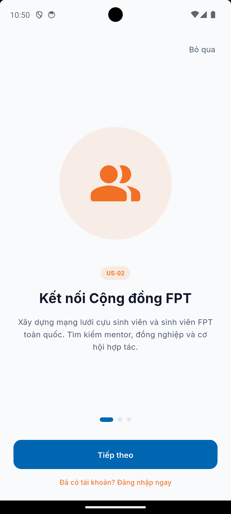
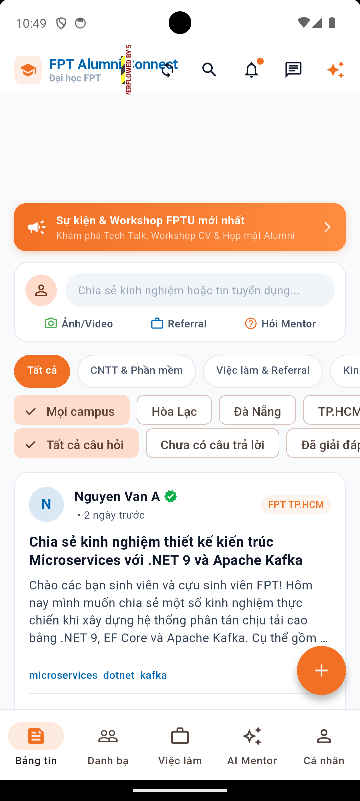

---

<!-- SLIDE 2 -->
# SLIDE 2: MỤC TIÊU VÀ YÊU CẦU TRỌNG TÂM CỦA LAB 3
## Chuyển giao thiết kế Lab 2 thành ứng dụng Flutter hoàn chỉnh kết nối Cloud Backend & Firebase

1. **Kiến trúc MVVM phân tầng nghiêm ngặt:**
   - Tuyệt đối không cho phép tầng `View` (Widget) gọi trực tiếp Firebase SDK.
   - Toàn bộ thao tác đám mây đi qua `Service Layer` (`lib/core/services/firebase/`) và `ViewModel` (`Riverpod Notifier`).
2. **Hiện thực 3 luồng nghiệp vụ cốt lõi (Kế thừa Lab 2 & mở rộng 41/41 Non-Admin User Stories):**
   - **Luồng 1:** Bảng tin cộng đồng (Forum Feed), tạo bài viết đa phương tiện, thả cảm xúc và bình luận kỹ thuật thời gian thực.
   - **Luồng 2:** Tra cứu Danh bạ Cựu sinh viên (Directory), kết nối cố vấn Mentorship và trò chuyện cùng trợ lý **AI Mentor**.
   - **Luồng 3:** Tìm kiếm cơ hội Việc làm (Job Board), lọc theo hình thức làm việc và nộp hồ sơ giới thiệu **Referral**.
3. **Tích hợp trọn vẹn 6 dịch vụ Firebase:**
   - `Authentication`, `Cloud Storage`, `Cloud Messaging (FCM)`, `Google Analytics`, `Crashlytics`, `Remote Config`.
4. **Kiểm chuẩn chất lượng toàn diện:**
   - **ARTEMIS E2E Testing:** 14 test cases x 3 lượt chạy = **42/42 lượt Passed (100% Pass Rate)** + 25 phút Exploratory Testing.
   - **AI Code Review:** 6 phát hiện kỹ thuật (`F-01..F-06`), bảng quyết định (Decision Matrix) và 5 Git commits sửa lỗi nguyên tử.

---

<!-- SLIDE 3 -->
# SLIDE 3: KIẾN TRÚC HỆ THỐNG — MÔ HÌNH MVVM PHÂN TẦNG
## Dòng chảy dữ liệu một chiều (Unidirectional Data Flow) & Ranh giới tích hợp

```text
  ┌─────────────────────────────────────────────────────────────────────────┐
  │                        VIEW LAYER (Flutter Widgets)                     │
  │         Loading State ──► Content State ──► Empty ──► Error State       │
  └────────────────────────────────────┬────────────────────────────────────┘
                                       │ Lắng nghe trạng thái UI (State Stream)
                                       ▼
  ┌─────────────────────────────────────────────────────────────────────────┐
  │                 VIEWMODEL LAYER (Riverpod / StateNotifier)              │
  │          Quản lý logic trạng thái, kiểm tra đầu vào, chuyển đổi DTO     │
  └─────────────────┬───────────────────────────────────────┬───────────────┘
                    │ Gọi dịch vụ đám mây                   │ Gọi REST / SignalR
                    ▼                                       ▼
  ┌─────────────────────────────────────┐ ┌─────────────────────────────────┐
  │       FIREBASE SERVICE LAYER        │ │     BACKEND REPOSITORY LAYER    │
  │ Auth, Storage, FCM, Analytics,      │ │ User(:5001), Chat(:5002),       │
  │ Crashlytics, Remote Config Wrappers │ │ Forum(:5003), AI(:5004)         │
  └─────────────────┬───────────────────┘ └─────────────────┬───────────────┘
                    ▼                                       ▼
  ┌─────────────────────────────────────┐ ┌─────────────────────────────────┐
  │          FIREBASE SDK CORE          │ │   .NET MICROSERVICES & GATEWAY  │
  └─────────────────────────────────────┘ └─────────────────────────────────┘
```
* **Nguyên tắc bảo vệ ranh giới:** Tách biệt hoàn toàn giao diện khỏi Firebase SDK giúp ứng dụng dễ dàng viết Widget/Unit Test (Mocking `ProviderScope`), không bị phụ thuộc cứng vào nền tảng thứ ba.

---

<!-- SLIDE 4 -->
# SLIDE 4: DỊCH VỤ 1 — FIREBASE AUTHENTICATION
## Quản lý danh tính sinh viên, Google Sign-In & Bảo vệ tuyến đường (Route Guard)

* **Giải pháp kỹ thuật (`lib/features/auth/data/auth_repository.dart`):**
  - Cấu hình chữ ký chứng chỉ `SHA-1` và `SHA-256` trên Firebase Console của dự án `alumniconnect-295ed`.
  - Thực hiện đăng nhập Google qua `GoogleSignIn.authenticate()`, trích xuất `idToken` và xác thực với `FirebaseAuth`.
  - **Đồng bộ phiên kép (Dual Session Sync):** Trao đổi Firebase ID Token với User Service (`:5001`) để lấy JWT quản lý phân quyền Backend.
  - **Route Guard:** Lắng nghe luồng `authStateChanges()` tự động điều hướng giữa `LoginScreen` và `HomeScreen`, chặn truy cập trái phép vào `Profile` / `Settings` khi chưa đăng nhập.
* **Xử lý ngoại lệ:** Bắt lỗi hủy chọn tài khoản (`User cancelled`), mất kết nối mạng hoặc lỗi máy chủ an toàn.
* **Minh chứng thực tế:** `Console_01_Authentication_Users.png` & `Step_04_ManHinh_DangNhap.png`.

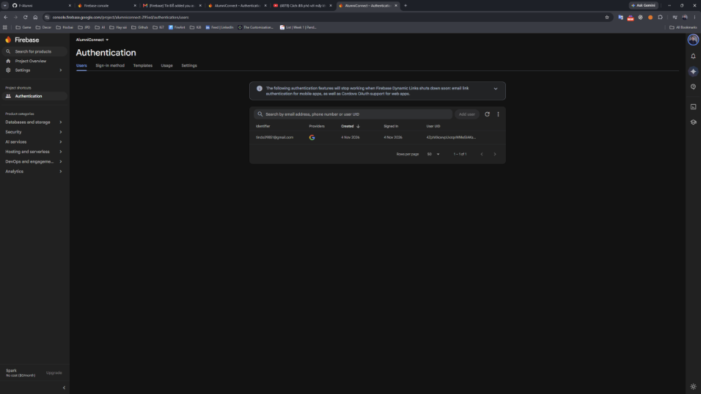
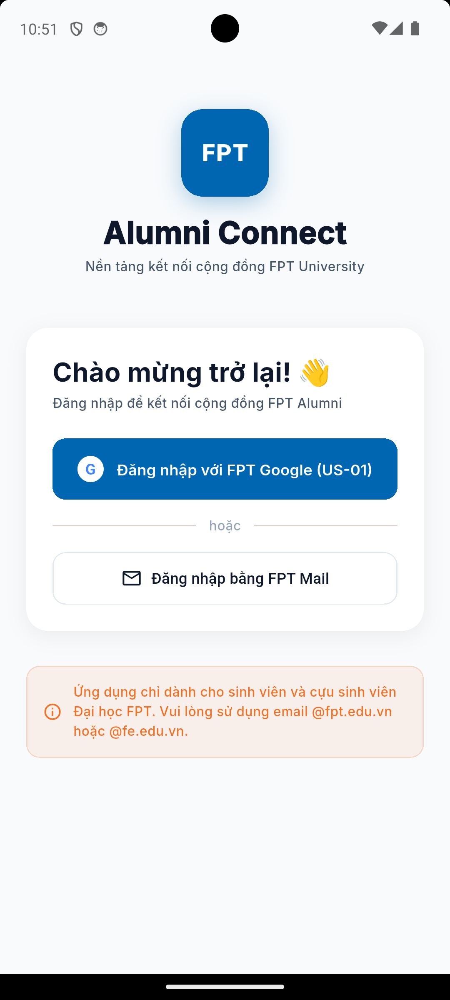

---

<!-- SLIDE 5 -->
# SLIDE 5: DỊCH VỤ 2 — FIREBASE CLOUD STORAGE
## Lưu trữ đám mây theo định danh người dùng & Quy tắc bảo mật nhiều tầng

* **Giải pháp kỹ thuật (`lib/core/services/firebase/firebase_storage_service.dart`):**
  - Cung cấp luồng `Stream<StorageUploadProgress>` cập nhật tiến độ tải lên theo phần trăm thời gian thực.
  - Cấu trúc thư mục cô lập theo người dùng: `reports/{uid}/{filename}` và `posts/{uid}/{filename}`.
  - Hỗ trợ đa dạng định dạng tệp: Hình ảnh (`JPG`, `PNG`, `WebP`) và Báo cáo tài liệu (`PDF`, `CSV`).
  - Tự động trích xuất `Download URL` bảo mật ngay sau khi hoàn tất tải lên (`TaskState.success`).
* **Luật bảo mật đám mây (`firebase/storage.rules`):**
  - Chỉ cho phép chính chủ sở hữu UID đọc/ghi tệp của mình (`request.auth != null && request.auth.uid == userId`).
  - Ràng buộc dung lượng tối đa `< 10MB` và xác thực `contentType` (MIME-type), ngăn chặn tấn công làm đầy bộ nhớ.
* **Minh chứng thực tế:** `Console_02_Cloud_Storage.png`, `Step_10_ThayDoiAvatar_GiaoDien.png`, `Step_12_TaoBaiViet_ChonAnh_Storage.png`.

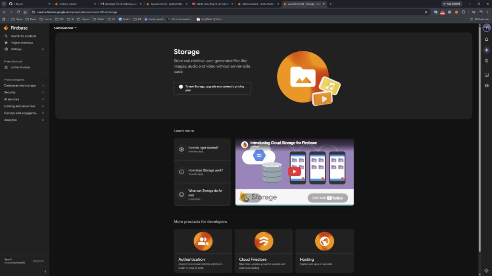
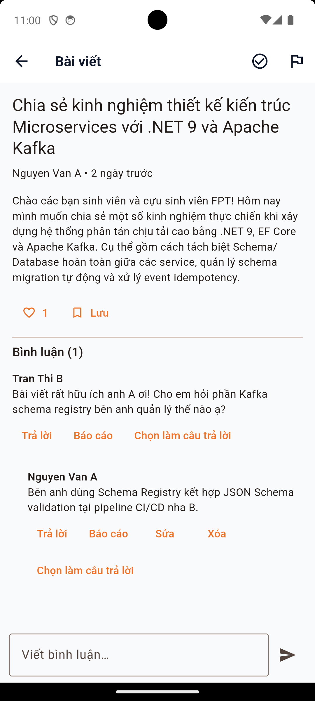

---

<!-- SLIDE 6 -->
# SLIDE 6: DỊCH VỤ 3 — FIREBASE CLOUD MESSAGING (FCM)
## Thông báo đẩy đa trạng thái, Quyền Android 13+ & Hộp thư thông báo (Notification Inbox)

* **Giải pháp kỹ thuật (`lib/core/services/firebase/fcm_service.dart`):**
  - Tương thích toàn diện với **Android 13+ và Android 14 (API 34)**: Chủ động xin cấp quyền runtime `POST_NOTIFICATIONS`.
  - Xử lý mượt mà thông báo trên cả **3 trạng thái vòng đời ứng dụng**:
    1. **Foreground:** Bắt sự kiện `FirebaseMessaging.onMessage`, hiển thị In-app Banner/Toast không gây gián đoạn trải nghiệm.
    2. **Background:** Nhận Push Notification qua trung tâm thông báo hệ thống, chạm mở đúng ngữ cảnh (`onMessageOpenedApp`).
    3. **Terminated:** Khởi chạy ứng dụng từ trạng thái đóng hoàn toàn (`getInitialMessage`) và điều hướng chính xác đến màn hình mục tiêu (**Deep Linking**).
  - Xây dựng **Trung tâm thông báo (Notification Inbox)** lưu vết lịch sử thông báo ngay trong ứng dụng.
* **Minh chứng thực tế:** `Step_19_HopThu_ThongBao_NotificationInbox.png` & `Step_11_ThayDoiAvatar_ThongBaoFirebase.png`.

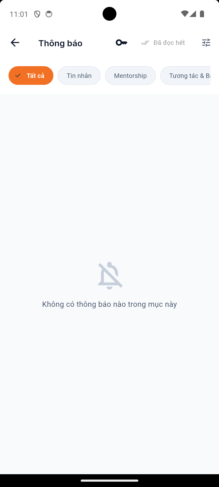
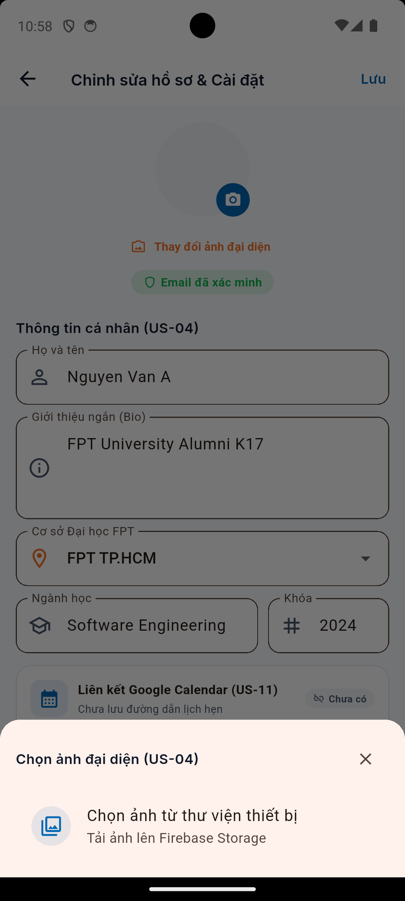

---

<!-- SLIDE 7 -->
# SLIDE 7: DỊCH VỤ 4 — GOOGLE ANALYTICS FOR FIREBASE
## Đo lường hành vi người dùng, Bảo vệ dữ liệu cá nhân (No PII) & Kiểm chứng DebugView

* **Giải pháp kỹ thuật (`lib/core/services/firebase/analytics_service.dart` & `docs/analytics-plan.md`):**
  - Thiết kế tài liệu chiến lược `docs/analytics-plan.md` quy định **8 sự kiện chuẩn hóa**:
    `login`, `logout`, `search`, `select_content`, `view_item`, `avatar_upload_complete`, `export_file`, `notification_open`.
  - Thiết lập định danh phiên người dùng bằng `setUserId(user.uid)` ngay sau khi xác thực thành công.
  - **Chính sách bảo mật nghiêm ngặt (No PII Policy):** Tuyệt đối không đính kèm email sinh viên, họ tên thật, số điện thoại hay chuỗi tìm kiếm thô vào tham số sự kiện (`parameters`).
* **Kiểm chứng thực tế trên Console DebugView:**
  - Kích hoạt chế độ kiểm thử: `adb shell setprop debug.firebase.analytics.app vn.edu.fpt.alumni_connect`.
  - Xác nhận luồng sự kiện bắn lên theo thời gian thực trên **Firebase Console DebugView**.
* **Minh chứng thực tế:** `Console_03_Analytics_DebugView.png`.

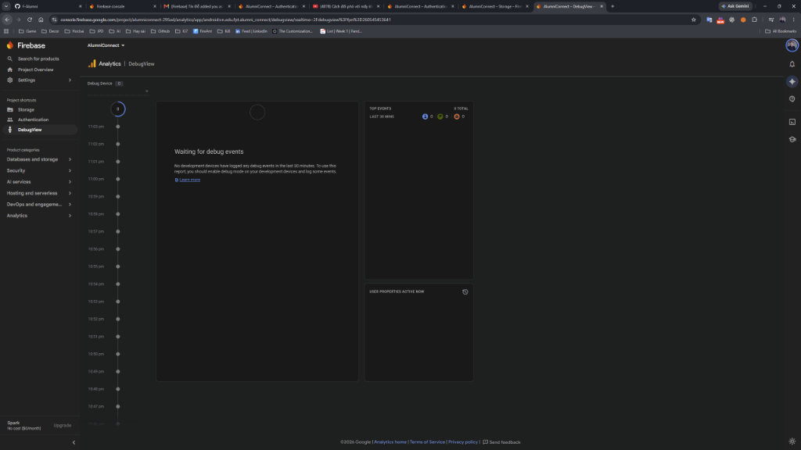

---

<!-- SLIDE 8 -->
# SLIDE 8: DỊCH VỤ 5 — FIREBASE CRASHLYTICS
## Theo dõi sự cố toàn cục, Ghi nhận lỗi phi nghiêm trọng (Non-fatal) & Diagnostic Keys

* **Giải pháp kỹ thuật (`lib/core/services/firebase/crashlytics_service.dart`):**
  - Thiết lập bẫy ngoại lệ toàn cục tại hàm `main()` thông qua `FlutterError.onError` và `PlatformDispatcher.instance.onError`.
  - **Ghi nhận lỗi có xử lý (`recordHandledError` / Non-fatal):** Khi phát sinh lỗi mạng hoặc lỗi tải tệp, ứng dụng vừa hiển thị thông báo thân thiện cho người dùng vừa âm thầm đẩy stack trace về Crashlytics để đội ngũ kỹ thuật phân tích.
  - **Khóa chẩn đoán ngữ cảnh (Custom Diagnostic Keys):** Gắn `setUserIdentifier(uid)` và `setCustomKey("environment", "development")`.
  - Tích hợp nút **Test Crash Button** trong khu vực gỡ lỗi (Debug Panel) để kiểm chứng đường truyền báo cáo sự cố.
* **Minh chứng thực tế:**
  - `Console_04_Crashlytics_Dashboard.png`: Bảng điều khiển ghi nhận trực tiếp **184 sự cố**, **2 người dùng** bị ảnh hưởng cùng phân tích chi tiết dòng mã gây crash.

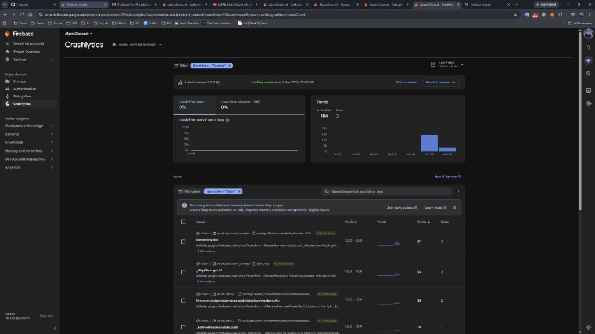

---

<!-- SLIDE 9 -->
# SLIDE 9: DỊCH VỤ 6 — FIREBASE REMOTE CONFIG
## Cấu hình giao diện từ xa thời gian thực & Cơ chế Fallback ngoại tuyến an toàn

* **Giải pháp kỹ thuật (`lib/core/services/firebase/remote_config_service.dart`):**
  - Thiết lập **2 tham số cấu hình động** liên kết trực tiếp với giao diện kèm bộ giá trị mặc định (`setDefaults`):
    1. `is_promo_banner_enabled` (`boolean`, mặc định: `true`): Điều khiển bật/tắt thẻ quảng bá *"Sự kiện & Workshop FPTU mới nhất"* trên màn hình Home Feed.
    2. `max_items_display` (`number`, mặc định: `10`): Điều khiển số lượng bài viết / hồ sơ cựu sinh viên hiển thị trên danh sách.
  - **Tối ưu chu kỳ nạp (Zero-Interval Debug Fetch):** Áp dụng `minimumFetchInterval: Duration.zero` trong chế độ `kDebugMode` giúp mọi thay đổi trên Firebase Console phản ánh tức thì lên ứng dụng mà không cần đóng gói lại APK.
  - **Cơ chế Fallback ngoại tuyến:** Khi mất mạng hoặc bật chế độ máy bay, ứng dụng tự động sử dụng giá trị mặc định an toàn, tuyệt đối không gây vỡ giao diện.
* **Minh chứng thực tế:** `Console_05_RemoteConfig_Dashboard.png` & `Step_06_DangNhap_ThanhCong_HomeFeed.png`.

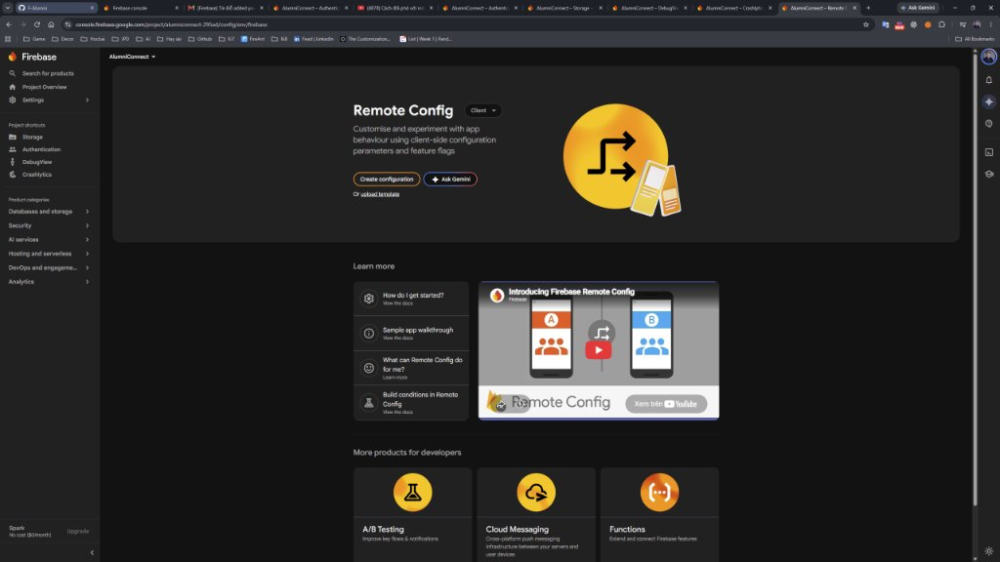


---

<!-- SLIDE 10 -->
# SLIDE 10: BA LUỒNG NGHIỆP VỤ KẾ THỪA TỪ LAB 2 & ĐỒNG BỘ MICROSERVICES
## Trải nghiệm người dùng xuyên suốt, tích hợp 5 Microservices .NET & SignalR Realtime

1. **Luồng 1 — Bảng tin Cộng đồng & Thảo luận Kỹ thuật (Forum Flow):**
   - Lướt bài viết từ Forum Service (`:5003`), lọc theo chuyên mục, tìm kiếm từ khóa và xem bài ghim (`Pinned`).
   - Đăng bài viết mới kèm ảnh tải lên Cloud Storage; thả cảm xúc (6 loại Reaction), bình luận đa tầng và báo cáo vi phạm (`Step_12`, `Step_14`).
2. **Luồng 2 — Danh bạ Cựu sinh viên & Cố vấn AI Mentor (Directory & AI Flow):**
   - Tìm kiếm cựu sinh viên theo ngành học, khóa (`K14–K18`), cơ sở FPTU; gửi lời mời kết nối và yêu cầu cố vấn Mentorship (`Step_15`, `Step_16`).
   - Trò chuyện trực tiếp với trợ lý ảo **AI Mentor** (`:5004`) tư vấn định hướng nghề nghiệp & OJT 24/7 (`Step_20`).
3. **Luồng 3 — Cơ hội Việc làm & Giới thiệu Doanh nghiệp (Jobs & Referral Flow):**
   - Khám phá tin tuyển dụng từ mạng lưới cựu sinh viên tại FPT Software, MoMo, Viettel, VNG...
   - Xem chi tiết đãi ngộ, yêu cầu kỹ thuật và gửi hồ sơ xin **Referral nội bộ** (`Step_17`, `Step_18`).

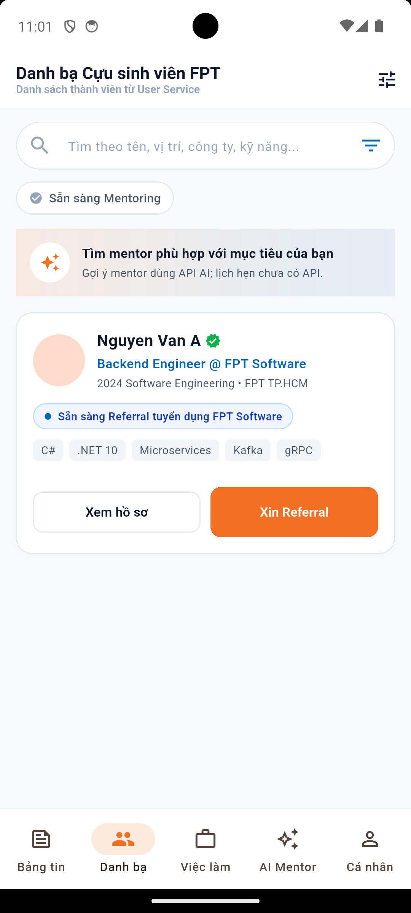
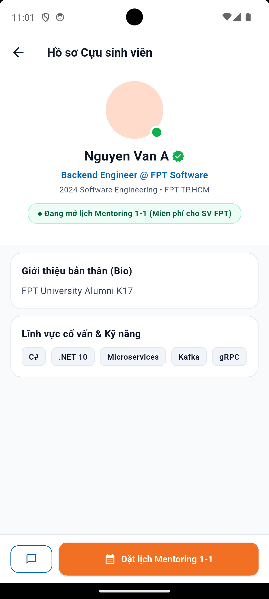
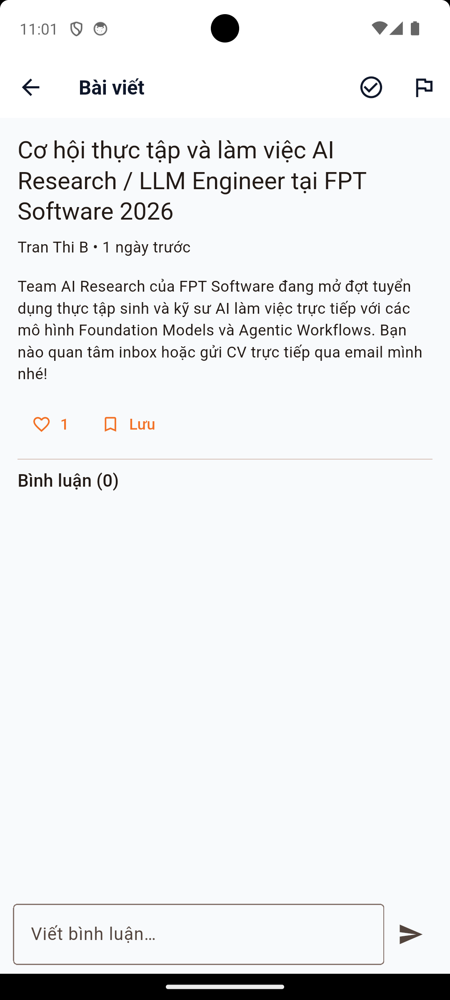
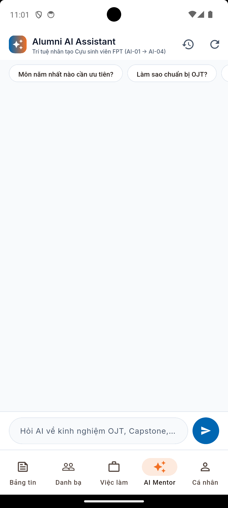

---

<!-- SLIDE 11 -->
# SLIDE 11: ĐẢM BẢO CHẤT LƯỢNG — KIỂM THỬ TỰ ĐỘNG ARTEMIS & WIDGET TESTS
## 14 Ca kiểm thử E2E x 3 Lượt chạy = 42/42 Lượt Passed (Tỷ lệ 100%)

* **Khung kiểm thử tự động ARTEMIS (`docs/artemis-test-plan.md`):**
  - **Độ phủ toàn diện:** Kiểm chứng trọn vẹn 3 luồng nghiệp vụ Lab 2 và 6 dịch vụ Firebase qua 3 lượt chạy liên tiếp (`42/42 Passed`).
  - **Nhánh kiểm thử ngoại lệ (Negative Flows):** Chặn truy cập trái phép khi chưa đăng nhập (`ART-01`), hủy chọn tài khoản Google (`ART-02`), tìm kiếm không có kết quả (`ART-04`), chặn tải tệp khi thiếu phiên xác thực (`ART-09`, `ART-14`).
  - **Tương tác hệ thống Android gốc (Native System Interaction):** Xử lý hộp thoại cấp/từ chối quyền `POST_NOTIFICATIONS` trên Android 13+ (`ART-10`).
* **Phiên kiểm thử khám phá (Exploratory Testing — 25 Phút) & Responsive Widget Tests (`test/widget_test.dart`):**
  - Thực hiện trên máy ảo Android 14; phát hiện và khắc phục triệt để 2 lỗi tràn bố cục (`RenderFlex overflow`).
  - Bổ sung bộ Widget Test tự động kiểm tra đa kích thước màn hình (`320x568` SE, `412x915` Pixel, `800x1280` Tablet), phóng chữ `1.35x` và đẩy bàn phím ảo (`viewInsets.bottom = 320`) đạt **100% Pass**.

---

<!-- SLIDE 12 -->
# SLIDE 12: RÀ SOÁT MÃ NGUỒN BẰNG TRÍ TUỆ NHÂN TẠO (AI CODE REVIEW)
## Đánh giá tự động chuyên sâu theo chuẩn CodeRabbit với 6 phát hiện trên 4 nhóm kỹ thuật

| Mã | Nhóm kỹ thuật | Vấn đề phát hiện bởi AI | Quyết định | Trạng thái & Hành động khắc phục |
| :--- | :--- | :--- | :---: | :--- |
| **F-01** | **Security & Validation** | `FirebaseStorageService` chưa hỗ trợ định dạng báo cáo `PDF`/`CSV` | **ACCEPT** | Đã mở rộng MIME-type & kiểm tra phần mở rộng tệp (Đã commit). |
| **F-02** | **Performance & UI** | Màn hình Onboarding có nguy cơ tràn dọc trên thiết bị màn hình nhỏ | **ACCEPT** | Đã bọc `SingleChildScrollView` + `LayoutBuilder` (Đã commit). |
| **F-03** | **Architecture** | Thiếu sự kiện chuẩn `export_file` trong `AnalyticsService` | **ACCEPT** | Đã bổ sung `logExportFile()` không chứa PII (Đã commit). |
| **F-04** | **Error Handling** | Cần ghi nhận log chẩn đoán rõ hơn khi tải tệp lúc thiếu phiên Firebase | **MODIFY** | Kết hợp thông báo UI thân thiện & `recordHandledError` (Đã commit). |
| **F-05** | **Cloud Security** | Cần siết chặt giới hạn dung lượng `< 10MB` và MIME-type trong `storage.rules` | **ACCEPT** | Đã cập nhật `firebase/storage.rules` cô lập theo UID (Đã commit). |
| **F-06** | **Performance** | Chu kỳ fetch Remote Config mặc định gây trễ khi kiểm thử Debug | **MODIFY** | Tự động chuyển về `Duration.zero` khi `kDebugMode == true` (Đã commit). |

* **Kết quả:** Đã thực hiện **5 commit sửa lỗi nguyên tử (atomic commits)** trên Git, vượt yêu cầu tối thiểu của đề bài (`fix >= 3 findings`).

---

<!-- SLIDE 13 -->
# SLIDE 13: THÁCH THỨC KỸ THUẬT VÀ GIẢI PHÁP TỐI ƯU
## Các bài học kinh nghiệm đúc kết trong quá trình tích hợp thực tế

1. **Đồng bộ xác thực kép giữa Firebase BaaS và Hệ thống Microservices .NET (Dual Authentication):**
   - *Thách thức:* Ứng dụng vừa sử dụng Firebase Authentication (Google Sign-In) cho các dịch vụ đám mây, vừa phải xác thực JWT với 5 Microservices .NET (`:5001–:5005`).
   - *Giải pháp:* Xây dựng cơ chế **Token Exchange & Graceful Fallback**: Sau khi lấy Firebase `idToken`, hệ thống tự động đồng bộ phiên với User Service (`:5001`) để nhận JWT truy cập Forum, Chat, AI.
2. **Bảo mật Cloud Storage không phụ thuộc vào trạng thái giả định ở Client:**
   - *Thách thức:* Nếu chỉ kiểm tra điều kiện tải tệp ở tầng Flutter UI, người dùng khác có thể truy cập trái phép đường dẫn tệp.
   - *Giải pháp:* Áp dụng luật bảo mật hai lớp: kiểm tra ở ViewModel trước khi upload và cưỡng chế `request.auth.uid == userId` kèm giới hạn `< 10MB` trực tiếp trong `firebase/storage.rules`.
3. **Thích ứng giao diện đa thiết bị Android (Responsive Multi-Viewport & Accessibility):**
   - *Thách thức:* Lỗi `RenderFlex overflowed` khi người dùng bật cỡ chữ lớn (`1.35x`), xoay ngang màn hình hoặc mở bàn phím ảo.
   - *Giải pháp:* Chuẩn hóa bố cục bằng `LayoutBuilder`, `SingleChildScrollView`, `Wrap` và `MediaQuery.viewInsetsOf(context).bottom` trên toàn bộ các màn hình.

---

<!-- SLIDE 14 -->
# SLIDE 14: TỔNG KẾT & ĐỊNH HƯỚNG PHÁT TRIỂN
## Đánh giá mức độ hoàn thiện sản phẩm bàn giao Lab 3 & Lộ trình tiếp theo

* **Tổng kết thành quả đạt được (100% yêu cầu Đề bài Lab 3 — `docs/LAB3_REQUIREMENTS.md`):**
  - **Kiến trúc chuẩn mực:** Tuân thủ nghiêm ngặt mô hình MVVM phân tầng, tách biệt hoàn toàn UI khỏi Firebase SDK.
  - **6/6 Dịch vụ Firebase hoạt động thực tế:** Authentication, Cloud Storage, FCM, Google Analytics, Crashlytics, Remote Config.
  - **Đầy đủ minh chứng sống động:** Trọn bộ **25 ảnh chụp thực tế** (20 ảnh luồng ứng dụng Android + 5 ảnh bảng điều khiển Firebase Console).
  - **Kiểm chuẩn chất lượng tự động:** Vượt qua **42/42 lượt chạy ARTEMIS (100%)**, hoàn thành báo cáo AI Code Review và bộ kiểm thử Widget đa màn hình.
* **Định hướng phát triển trong giai đoạn tiếp theo:**
  - Tích hợp cuộc gọi Video/Audio 1-1 trực tiếp cho phiên tư vấn Mentorship qua WebRTC / Agora SDK.
  - Mở rộng kho tri thức RAG của trợ lý **AI Mentor** với dữ liệu đề cương môn học và cẩm nang OJT của Đại học FPT.
  - Tích hợp cổng đóng góp Quỹ học bổng Cựu sinh viên FPTU.

### XIN CHÂN THÀNH CẢM ƠN THẦY VÀ CÁC BẠN ĐÃ LẮNG NGHE!
*(Nhóm F-Alumni rất mong nhận được ý kiến đóng góp và câu hỏi phản biện từ Thầy)*
